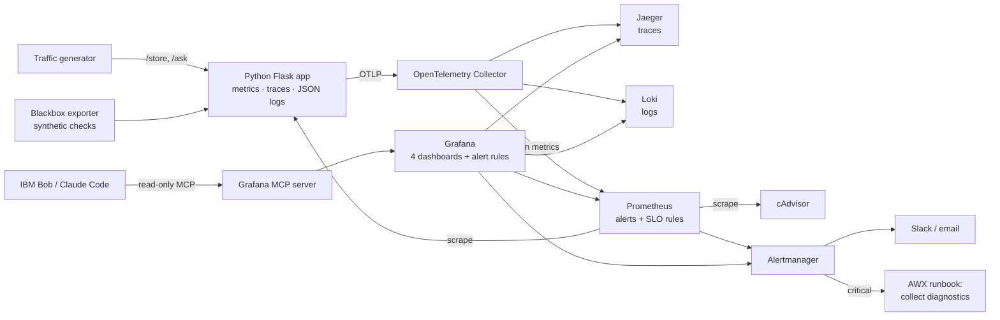
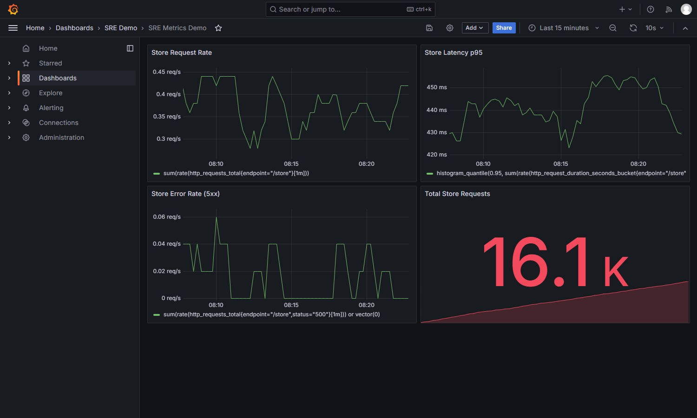

# SRE Academy Mega Lab: AI SRE onboarding with IBM Bob

[](https://github.com/jaffethalfarotorres/sre-final-project/actions/workflows/ci.yml)
[](https://github.com/jaffethalfarotorres/sre-final-project/actions/workflows/cd.yml)
[](LICENSE.md)
[](app/app.py)
[](docs/GUIDE.md)
[](docs/BOB-QUICKSTART.md)

**In plain words:** this project runs a small pretend online shop on your laptop, measures how healthy it is, shows the measurements as live charts, raises an alarm in Slack or email when something goes wrong, and lets you practise what Site Reliability Engineers do next: investigate, roll back, automate the fix and learn from the incident, now including AI assistants that help without being allowed to break anything.

It started as my SRE Academy 2026 final project and grew into a **complete, reusable lab**. It covers every topic and exercise of the 2026 course on one working stack, adds the topics a 2027 class needs (AI-assisted operations with IBM Bob, Claude Code optional, MCP safety, supply chain security, policy as code, canary releases, DORA metrics, LLM observability), and comes with a lab guide that professors can teach from.

## Start here: let IBM Bob guide you

Built for **non-technical students**. Paste one message into [IBM Bob](https://bob.ibm.com) and Bob installs the tools, sets up the lab on your laptop and then guides you through the missions, explaining every idea in plain words. You learn SRE, the tools and how to work with an AI partner at the same time, earn **XP, levels and badges**, and finish with a **self-generated SRE Lab Passport** that your professor confirms in a short live check-off.

**→ [Start the lab with IBM Bob](docs/BOB-QUICKSTART.md)** (about 2 hours of setup, then one mission at a time)

| You are... | Start with |
| --- | --- |
| A student with IBM Bob | [BOB-QUICKSTART.md](docs/BOB-QUICKSTART.md): open the folder in Bob, choose the **SRE Lab Guide** mode, type `/start-lab` |
| A student without Bob | The [step-by-step guide for Mac and Windows](docs/GUIDE.md), then `python3 scripts/lab.py status` (Windows: `python scripts\lab.py status`; or `/lab` in Claude Code) |
| A professor | The [lab guide](docs/labs/README.md) (objectives, timing, instructor notes, assessment), the [course map](docs/COURSE-MAP.md) and the [instructor notes on answer keys](docs/instructor/README.md) |

A mission counts only when [`scripts/lab.py`](scripts/lab.py) finds the evidence on the student's own cluster or fork; the professor confirms it live with `lab.py verify`. Quizzes are for learning and never count toward a grade.

### The journey: Road to Junior SRE

The lab is one journey, built for IBMers from non-technical teams who want to move into technical roles such as junior SRE, DevOps, cloud or operations. The student's first assignment as an apprentice is **Nimbus Store** (the demo app), a small online shop that went down for an hour last week and nobody noticed. With **Bob, the student's AI pair** (fast and helpful, never allowed to change anything without the student's OK), the student climbs camp by camp from **Career Changer** to the summit **On-Call Ready**: the day a team trusts them with the pager. Each camp gives Nimbus a real capability, teaches one SRE principle, lists skills the student can name on a CV and adds one interview question to rehearse with Bob (`lab.py cv`, Bob: `/my-cv` and `/interview`). The lab gives hands-on evidence for junior roles; it does not claim to make anyone a senior engineer.

| Camp | SRE principle |
| --- | --- |
| 0. Orientation Day | Humans stay in control: automation and AI propose, people approve |
| 1. The Engine Room | Reliability starts with small, safe, repeatable changes |
| 2. The Watchtower | Monitor what users feel, and alert only when a human must act |
| 3. The War Room | Embrace risk with SLOs and error budgets; learn from incidents without blame |
| 4. The Detective Agency | Observability: explain any failure from evidence, not guesses |
| 5. The Robot Workshop | Eliminate toil: automate repetitive work and keep infrastructure in code |
| 6. The Proving Grounds | Release engineering: gradual, reversible changes, tested by breaking things on purpose |
| 7. The AI Command Center | Trust, but verify: AI helps on call only with least privilege and human judgement |

Ranks by XP: Career Changer (0) → Tech Apprentice (500) → SRE Intern (1300) → Junior SRE Candidate (2300) → Interview-Ready Junior SRE (3300). The missions are B00 (orientation, with the "Stay in control" safety rules), core missions M00-M23 including **M09b** (work in your own fork), six optional add-ons, and the capstone game day **M27**.

**Portfolio projects** (optional, open to everyone, pieces to show in interviews):

| Project | What the student builds | Badge |
| --- | --- | --- |
| **P-DASH** | Their own Grafana dashboard | Dashboard Builder |
| **P-ENV** | A second `dev` environment with a Terraform workspace | Environment Builder |
| **P-RUNBOOK** | A new runbook linked from an alert's `runbook_url` | Runbook Author |
| **P-POLICY** | A new Kyverno ClusterPolicy | Guardrail Author |

**Badges** are earned along the way, for example *Paired with AI* (B00), *Hello, Cluster* (M00), *First Page* (M05), *Budget Keeper* (M06), *Storyteller* (M09), *Rollback Hero* (M14), *AI Wrangler* (M17), *Injection Proof* (M18) and *Game Day Captain* (M27), plus one per add-on and portfolio project. `lab.py play` (Bob: `/mission-control`) opens Mission Control, the visual dashboard of the climb, with "Your CV so far" and "Interview practice" panels.

Professors get a class summary with `python3 scripts/cohort_report.py <folder of the students' lab-proof/evidence.json files>` (Windows: `python scripts\cohort_report.py ...`): how many students reached On-Call Ready, the missions most students skipped (topics to reteach) and a fingerprint check of each file. The passport is a self-generated record, not a certificate; its fingerprint is not a signature, so confirm a sample with `lab.py verify` or a short live demo.

## What you get



| Area | What is in the repository |
| --- | --- |
| **App** | Flask service with Prometheus metrics, OpenTelemetry traces, JSON logs with trace IDs, a GenAI demo endpoint and a prompt-injection drill ([`app/app.py`](app/app.py)) |
| **Observability** | Prometheus, Grafana, Alertmanager, Loki, Jaeger, OpenTelemetry Collector, blackbox exporter, cAdvisor; all config as code under [`k8s/`](k8s/) |
| **Reliability** | SLOs with multi-window burn-rate alerts, runbooks, incident process, postmortem template, ORR ([`docs/`](docs/)) |
| **Automation** | Ansible playbooks and AWX, Terraform, Helm, Kustomize |
| **Delivery** | GitHub Actions CI/CD, ArgoCD GitOps, rolling updates and rollback, Argo Rollouts canary gated by the SLO |
| **Resilience and guardrails** | LitmusChaos experiments, Kyverno policies, SBOM, image scanning and signing |
| **AI-assisted SRE** | Shared [`AGENTS.md`](AGENTS.md) for IBM Bob and Claude Code, read-only MCP access, guard hooks, injection drill ([`docs/AI-SRE.md`](docs/AI-SRE.md)) |

## Quick start

On a **Mac** (Homebrew + Colima) or **Windows** (WSL2 + Ubuntu), with Docker, Minikube and kubectl installed ([guide, step 2](docs/GUIDE.md#2-install-the-tools-one-time)):

```bash
git clone https://github.com/jaffethalfarotorres/sre-final-project.git
cd sre-final-project
./scripts/deploy.sh          # builds the app and deploys the whole stack (5-10 minutes the first time)
./scripts/dashboards.sh      # opens Grafana, Prometheus, Alertmanager, Jaeger and the app
./scripts/trigger-alert.sh   # in another window: makes a real alert fire in about 2.5 minutes
```

No accounts or credentials are needed. **On Windows with IBM Bob, use PowerShell and skip WSL:** every script also exists as `scripts\*.ps1` (for example `powershell -NoProfile -ExecutionPolicy Bypass -File scripts\deploy.ps1`), and you type `python`, never `python3`. The tunnels can run in the background: `scripts\dashboards.ps1 -Background` (Mac/Linux: `./scripts/dashboards.sh --background`), stopped with `-Stop` / `--stop`.

## The lab path

| Part | Modules | Course coverage |
| --- | --- | --- |
| [1. Foundations](docs/labs/01-foundations.md) | Setup, instrumentation, Docker, Kubernetes | Ex 1-4 |
| [2. Metrics, dashboards and alerts](docs/labs/02-metrics-dashboards-alerts.md) | Prometheus, Grafana, Alertmanager, Grafana alerting, golden signals | Ex 5-7, 11, 12 |
| [3. SLOs and incidents](docs/labs/03-slos-and-incidents.md) | SLOs and error budgets, synthetic checks, incident response, ORR, GitHub | Topics 0-6 |
| [4. Logs, traces and LLM observability](docs/labs/04-logs-traces-llm.md) | OpenTelemetry, Jaeger, Loki, GenAI telemetry | Ex 8-10 + new |
| [5. Automation, IaC and CI/CD](docs/labs/05-automation-iac-cicd.md) | Forking the repo (M09b), Ansible, AWX, Terraform, Helm, GitHub Actions, DORA, supply chain | Ex 4.1, 13-16 + new |
| [6. GitOps, resilience and guardrails](docs/labs/06-delivery-resilience-policy.md) | ArgoCD, rollbacks, chaos, Kyverno, canary | Ex 17-19 + new |
| [7. AI-assisted SRE](docs/labs/07-ai-assisted-sre.md) | IBM Bob (Claude Code optional), MCP safety, injection drill, game day | New in 2027 |

Every 2026 topic and exercise, and the roadmap.sh DevOps areas, are mapped to files in the [course map](docs/COURSE-MAP.md).

## Optional add-ons (one at a time)
The core stack uses about 3.5 GB. `./scripts/deploy.sh` creates a 4 GB Minikube, which is enough for the core stack only. For the add-ons (16 GB laptop), first create a 6 GB cluster with `minikube start --driver=docker --memory=6144` (run `minikube delete` first if a cluster already exists, because `minikube start` cannot change the memory of an existing cluster; on a Mac, run `colima stop && colima start --cpu 4 --memory 8` first), then run `./scripts/deploy.sh`. Run one add-on, then remove it before the next. On an 8 GB laptop, stay with the core stack. The commands below are for Mac/Linux; on Windows type `python scripts\<name>.py` instead of `python3 scripts/<name>.py`.

| Add-on | Command | Extra memory | What it proves (verified) |
| --- | --- | --- | --- |
| ArgoCD | `python3 scripts/gitops_setup.py` | ~0.8 GB | Synced from GitHub; a manual change is reverted in ~5 s |
| Chaos | `python3 scripts/chaos_test.py` | ~0.5 GB | Pods killed for 30 s, the app kept answering, verdict Pass |
| Canary | `python3 scripts/canary_demo.py` | ~0.4 GB | Good release promoted; bad release stopped at 25% and rolled back |
| Kyverno | `python3 scripts/policy_setup.py` | ~0.5 GB | A non-compliant pod is rejected with 3 policy messages |
| AWX | `python3 scripts/awx_setup.py` | ~2.5 GB | A critical alert launches the diagnostics runbook ~14 s later |
| AI access | `python3 scripts/ai_setup.py` | ~0.05 GB | MCP server (about 60 tools, Grafana writes refused by a Viewer token) and a kubeconfig that cannot delete |
| Bad release | `python3 scripts/rollout_demo.py` | none | Users kept being served; rollback in ~1 s |
| Terraform | `cd terraform && terraform init && terraform apply` | ~0.2 GB | A staging copy of the app created and destroyed from code |

## Final project requirements

| Requirement | Implementation |
| --- | --- |
| 1. Application | Python Flask app emitting metrics, traces and logs ([`app/app.py`](app/app.py)); 61 automated tests for the app and the AI guard hook |
| 2. Kubernetes | Minikube, Kustomize, 2 replicas, probes, limits, non-root, rolling updates |
| 3. Prometheus | Pod discovery by annotation, cAdvisor, blackbox and span-metric jobs; 5 alert rules + 16 SLO rules |
| 4. Grafana | 4 provisioned dashboards: overview, golden signals, SLO and error budget, LLM observability |
| 5. Alertmanager | Severity routing to Slack, email and AWX; Grafana alerts flow through the same routes |
| 6. Documentation | This README, a beginner guide, 7 lab parts, runbooks, SLO/ORR/incident docs, [`LICENSE.md`](LICENSE.md), [`CONTRIBUTING.md`](CONTRIBUTING.md), screenshots |
| Bonus: notifications | Slack and email receivers ([`k8s/alertmanager.yaml`](k8s/alertmanager.yaml)); setup in [guide section 6](docs/GUIDE.md#6-optional-get-alerts-in-slack-and-email) |
| Bonus: IaC | Helm, Terraform, Ansible, Kustomize |
| Bonus: CI/CD | CI: tests, security scans, config validation, multi-arch build, scripts checked on Linux, macOS and Windows. CD: GHCR, SBOM, vulnerability gate, signing, provenance, Helm chart release |

## Evidence

Screenshots of the working deployment are in [`docs/screenshots/`](docs/screenshots/).

**All pods running** · **Prometheus target UP** · **Grafana dashboard with live data**




**Prometheus alerts** · **Alertmanager with a firing `HighErrorRate`** · **Helm deployment**


## Repository layout

```
app/            Flask service (metrics, traces, logs, /ask GenAI demo, /inject drill)
k8s/            Kustomize stack: manifests + config/ (Prometheus, Grafana, Collector, Loki), ai/, drills/
helm/           App chart + kube-prometheus-stack values (alternative install: ./scripts/deploy.sh --helm)
ansible/        Deploy playbook and incident runbooks      awx/        AWX operator, instance, RBAC
terraform/      Staging environment as code                 gitops/     ArgoCD project and application
chaos/          LitmusChaos experiment as an Argo Workflow  policy/     Kyverno policies
progressive/    Argo Rollouts canary + SLO analysis         scripts/    One-command tools (bash, PowerShell, Python)
docs/           Guide, lab parts, SLO, ORR, incident response, runbooks, course map
.claude/ .bob/  AI assistant configuration (shared rules in AGENTS.md)
```

## CI/CD
- **CI** on every push and pull request: flake8 and pytest, bandit and pip-audit, Kustomize/Helm/kubeconform, promtool, amtool, Collector and Loki config checks, Terraform and Ansible (production lint profile), a multi-arch image build, and the scripts checked on Linux, macOS (bash 3.2) and Windows (PowerShell).
- **CD** on a version tag (`v1.0.0`): image pushed to GHCR (and Docker Hub if its secrets exist), SBOM, Trivy gate, cosign signature, SLSA provenance, a kind smoke test and the Helm chart attached to the GitHub Release.

## Clean up

```bash
kubectl delete namespace application monitoring opentelemetry
minikube stop        # or: minikube delete
```

## Notes
A teaching lab: data is not persisted, and every credential is local and short-lived. Keep real webhook URLs and passwords out of Git; only `*.example.yaml` Secret files are tracked.

## License
MIT, see [`LICENSE.md`](LICENSE.md). Contributions are welcome, see [`CONTRIBUTING.md`](CONTRIBUTING.md).
