# SRE Academy: your first on-call shift, guided by your AI coding agent

[](https://github.com/jaffethalfarotorres/sre-final-project/actions/workflows/ci.yml)
[](https://github.com/jaffethalfarotorres/sre-final-project/actions/workflows/cd.yml)
[](LICENSE.md)
[](app/app.py)
[](docs/GUIDE.md)
[](docs/BOB-QUICKSTART.md)

**What this is, in plain words:** an ice-breaker for Site Reliability Engineering (SRE: the people who keep online services working), guided by your AI coding agent: [IBM Bob](https://bob.ibm.com) for IBMers, or Claude Code, Codex and others. You open your agent, paste the link to this repository, and in **one sitting of about 2-3 hours once the laptop is ready (estimated)**, most of it waiting for installs, the agent sets up a real SRE toolchain on your laptop and walks you through your **first on-call shift**: live dashboards, an alert that reaches your phone, the trace of one failing request, and an AI teammate that investigates safely without being allowed to break anything.

You do not need a technical background. Nobody grades it. The agent does the work, you approve and watch, and it explains what you see. New words? See the [glossary](docs/GUIDE.md#glossary) or the [FAQ](docs/FAQ.md).

## Start here: step by step (never used IBM Bob? This is for you)

You only need this page. You will not type commands: IBM Bob types them, you click **Approve** and watch, and Bob explains what is happening in plain words, so you learn while it works. Ask it anything, any time ("what is Kubernetes?", "why did that alarm go off?").

**What you will learn by the end:** what SRE people do all day; how a website is watched with **metrics** (numbers over time), **logs** (what happened) and **traces** (the path of one click); how an **alert** decides to wake someone up and reaches a phone; and how to work safely with an AI that proposes and you decide.

Plan **about 1 hour** the first time (most of it is waiting for downloads), on a laptop with **16 GB of memory** (8 GB works, slower) and **25 GB of free disk**.

**Before you start (5 minutes, once)**
1. **Get IBM Bob.** IBMers: install it from [bob.ibm.com](https://bob.ibm.com) and sign in with your IBM account. Not at IBM? The same page has a free trial. (Another AI coding agent such as Claude Code also works: [see below](#start-with-your-ai-coding-agent).)
2. **Make an empty folder** for the lab. Windows: open **File Explorer**, go to **Documents**, right-click > **New > Folder**, name it `sre-lab`. Mac: in **Finder**, open **Documents**, right-click > **New Folder**, name it `sre-lab`.

**Start the lab (2 minutes of clicking, then you watch)**

3. **Open IBM Bob.** It looks like a code editor with a chat panel. If it shows a welcome page, close it.
4. **Open your empty folder in Bob:** menu **File > Open Folder…**, pick `sre-lab`, click **Select Folder** (Mac: **Open**). If Bob asks *"Do you trust the authors of the files in this folder?"*, click **Yes, I trust the authors**. Why a folder? Bob works inside the folder you open: it is where it downloads the lab.
5. **Open the Bob chat** if you do not see it: click the **Bob icon** in the left or right side bar. At the bottom of the chat there is a **mode** menu: choose **Agent**. (Agent is the mode that can do things on your laptop. Ask and Plan modes only talk.)
6. **Copy this message, paste it into the Bob chat and press Enter:**

   ```text
   Set up the SRE lab from https://github.com/jaffethalfarotorres/sre-final-project on my laptop and show me every tool working. I am not technical: do the work for me, explain in plain words, and ask for my OK before each command. Follow the "Note for AI coding agents" in its README.
   ```

7. **Click Approve when Bob asks.** Before each command, Bob shows it with a short reason and two buttons: **Approve** (or **Run**) and **Reject**. Read the reason and click **Approve**. The first time, Bob may show *"I understand the risks"*: accept it; it only means you approve each command yourself. Do **not** turn on auto-approve for Execute or Write.
8. **Windows pop-ups are your job.** An installer may ask *"Do you want to allow this app to make changes?"*: click **Yes**. If Docker Desktop or Rancher Desktop opens for the first time, accept its terms and wait until it says it is running, then type `done` in the Bob chat.
9. **Wait and watch** (15-40 minutes the first time). Bob downloads the tools, starts a small **Kubernetes** (a mini data center inside your laptop), installs **Nimbus Store** (a tiny online shop) and the tools that watch it. If something is blocked on an IBM laptop, Bob shows you the [IT request](docs/IT-REQUEST.md) to send.
10. **See it working.** When it is ready, your browser opens these pages, and Bob explains each one:

    | Page | What you see |
    | --- | --- |
    | <http://localhost:5000> | **Nimbus Store**, the shop |
    | <http://localhost:3000> | **Grafana**: live charts of the shop. No login needed to look; to change things, user `admin`, password `admin` |
    | <http://localhost:9090/targets> | **Prometheus**: everything it measures, all green (UP) |
    | <http://localhost:16686> | **Jaeger**: the path of each click through the shop |
    | <http://localhost:9093> | **Alertmanager**: the alarms |

**Play with it (type these in the Bob chat, in plain words)**
- `Break the shop on purpose and show me the alert` (the alert drill: in about 3 minutes an alarm goes off, and you follow it from chart to Alertmanager).
- `Send the alerts to my phone` (free ntfy app, no account; Bob tells you what to tap).
- `What am I looking at?` on any page, at any time.
- `Start my first on-call shift` for the guided version with 9 steps, short quizzes and a badge.
- `Stop the lab` when you are done (frees the memory). Next time, open the same folder in Bob and type `Start the lab again`.

> **Note for AI coding agents (IBM Bob, Claude Code, Codex and others) reading this page from a pasted link:** the person is usually not technical and wants to **see the lab running**, not a plan. Do not write a plan, a checklist or any file, and never commit, push or create a repository. With their OK: clone `https://github.com/jaffethalfarotorres/sre-final-project.git` into the folder that is open (if git is missing, install it first: Windows `winget install -e --id Git.Git`, or tell them which installer to click), work inside the `sre-final-project` folder, read its `AGENTS.md` (section "First message") and follow it. Their plain-words requests map to: "break the shop" → `lab_up.py --drill`; "alerts to my phone" → `scripts/notify_setup.py`; "stop the lab" → `lab_up.py --stop`; "start the lab again" → `lab_up.py`; "first on-call shift" → AGENTS.md "The lab game". In short, run `python scripts/lab_up.py` (Windows `python scripts\lab_up.py`), which installs what is missing, deploys everything on this laptop and checks that every tool is connected. Then give the tour and run the alert drill (`lab_up.py --drill`). A teacher who wants a written check also gets `python scripts/smoke_test.py --cluster --report reports/smoke-test.md`.

<a id="start-with-your-ai-coding-agent"></a>
**Start with your AI coding agent.** The first message to paste is in [BOB-QUICKSTART.md, Step 1](docs/BOB-QUICKSTART.md#step-1-paste-this-into-your-ai-coding-agent). It works in any AI coding agent (in IBM Bob, use **Agent** mode). The agent installs the tools, gets the lab and brings it up with one command, [`scripts/lab_up.py`](scripts/lab_up.py), then shows you every tool working. For the guided shift with quizzes and a badge, open the `sre-final-project` folder in your agent:

| Your agent | How it reads this lab | How to start |
| --- | --- | --- |
| **IBM Bob** (recommended for IBMers) | [`.bob/`](.bob/) (modes, rules, slash commands) plus [`AGENTS.md`](AGENTS.md) | Choose the mode **SRE Lab Guide**, type `/start-lab` |
| **Claude Code** | [`CLAUDE.md`](CLAUDE.md) (imports `AGENTS.md`), the `/lab` skill in [`.claude/skills/lab/`](.claude/skills/lab/) and the `sre-triage` subagent | Type `/lab` |
| **Others** (OpenAI Codex, Google Antigravity, Cursor...) | [`AGENTS.md`](AGENTS.md), the shared entry point that many agents read | Paste `Read AGENTS.md and guide me through the First on-call shift` |

**Tested with:** the shift and the AI triage drill were run with Claude Code on the author's laptop. The IBM Bob setup was written for Bob 2.x, but a full shift in Bob has not been timed yet. Other agents follow `AGENTS.md` but were not tested. More in [Use any AI coding agent](docs/BOB-QUICKSTART.md#use-any-ai-coding-agent).

**→ [Start your first on-call shift](docs/BOB-QUICKSTART.md)**

<a id="the-first-on-call-shift"></a>
## Your first on-call shift: 9 steps, about 165 minutes

The minutes are estimates for a laptop that is ready (admin rights, disk space, a container engine). They have not been timed with a real class yet.

The pretend shop is **Nimbus Store**. It went down for an hour last week and nobody noticed. Today you make sure that never happens again.

| # | Mission | What you do | Minutes |
| --- | --- | --- | --- |
| 1 | B00 Meet your AI partner | Learn how you and your agent (Bob for IBMers) work together, including the "Stay in control" rules | 15 |
| 2 | M00 Boot the lab | Run `scripts/preflight.py`, then the one-command setup kit `scripts/install-tools.*` installs what is missing, and the agent deploys the stack (mostly waiting) | 60 |
| 3 | M01 Instrument a service | See the numbers, traces and logs the shop sends out | 10 |
| 4 | M04 Dashboards as code | Open Grafana and read the live charts | 10 |
| 5 | M05 First alert | Break the shop on purpose (`scripts/trigger-alert.*`) and watch an alert fire | 15 |
| 6 | N01 Alerts on your phone | Run `scripts/notify_setup.py`, subscribe in the free ntfy app or a browser, and get a real `[firing]` push | 10 |
| 7 | M07 Follow the trace | Follow one failing request step by step in Jaeger | 10 |
| 8 | M17 AI on call | Turn on the agent's read-only access (`scripts/ai_setup.py`) and let it triage the alert (Bob: **SRE Triage** mode and `/save-triage`; Claude Code: the `sre-triage` subagent) | 20 |
| 9 | M18 Injection proof | See the agent spot a planted instruction in the logs and refuse to follow it | 15 |

When all nine are done you get a **SHIFT COMPLETE** moment and the **First On-Call Shift** badge. Check where you are at any time with `python scripts\lab.py journey` on Windows (Mac and Linux: `python3 scripts/lab.py journey`). Everything else in this repository is optional: see [Keep exploring](#keep-exploring).

## Start here, by audience

| You are... | Read this first | Then |
| --- | --- | --- |
| **An IBMer trying SRE for the first time** | [BOB-QUICKSTART.md](docs/BOB-QUICKSTART.md): paste one message into IBM Bob (or another [AI coding agent](#start-with-your-ai-coding-agent)) and follow the [9 steps](#the-first-on-call-shift) | First check your laptop with `python scripts\preflight.py` on Windows (Mac: `python3 scripts/preflight.py`). If something is blocked, send IT the [IT request template](docs/IT-REQUEST.md) |
| **The grader** | The [grader view](#final-project-grader-view) just below (rubric to file to screenshot). To check it on your laptop, paste the repository link into your AI coding agent and say "I want to check the project" (IBM Bob: `/smoke-test`), or run `python scripts/smoke_test.py` yourself: the main CI checks, read-only, about 2 minutes | The [FAQ](docs/FAQ.md) (alert path, burn-rate math, design choices, limits) and the evidence: [screenshots](#evidence), [AI triage drill](docs/evidence/ai-triage-2026-11-19.md), [postmortem](docs/postmortems/2026-11-19-alert-drill-and-ai-triage.md) |
| **A professor or team lead running a session** | The [instructor notes](docs/instructor/README.md) (how to run it as one class session) | The [course map](docs/COURSE-MAP.md) and the [lab guide](docs/labs/README.md) (the shift first, then optional deeper parts) |
| **A team that onboards SRE new hires or interns** | [Reuse it for onboarding](#reuse-it-for-onboarding) | The mission catalog [`lab/missions.json`](lab/missions.json) and [`scripts/lab.py`](scripts/lab.py) |
| **A classmate who only wants to understand it** | The plain-words paragraph at the top of this page, then [GUIDE section 1, "What is this project?"](docs/GUIDE.md#1-what-is-this-project) | The [step-by-step guide](docs/GUIDE.md) and its [glossary](docs/GUIDE.md#glossary) |
| **A hiring manager** | [What I built](#what-you-get) and [How this was built](#how-this-was-built) (what I did, what the AI did) | The [evidence](#evidence), a [real drill postmortem](docs/postmortems/2026-11-19-alert-drill-and-ai-triage.md) (time to detect 2 min 19 s) and the [CI runs](https://github.com/jaffethalfarotorres/sre-final-project/actions/workflows/ci.yml) |

This repository is also my SRE Academy 2026 final project. There is no presentation: the repository is the whole submission, and the [FAQ](docs/FAQ.md) answers the questions I would get in person, with links to the proof. The rubric mapping is right below.

<a id="final-project-requirements"></a>
## Final project: grader view

This table maps the official rubric to the repository. Each row links to the file and to the evidence. The [FAQ](docs/FAQ.md#2-from-a-failing-request-to-a-phone-push) walks one failing request all the way to a phone push.

| Requirement | Where it is | Evidence |
| --- | --- | --- |
| 1. Application emits metrics | Python Flask app with Prometheus metrics (numbers over time), OpenTelemetry traces (the path of one request) and JSON logs: [`app/app.py`](app/app.py); tests in [`tests/`](tests/) | [grafana-golden-signals.png](docs/screenshots/grafana-golden-signals.png), [jaeger-trace.png](docs/screenshots/jaeger-trace.png), [grafana-loki-logs.png](docs/screenshots/grafana-loki-logs.png) |
| 2. Kubernetes deployment | Minikube (Kubernetes on one laptop) and Kustomize (built into kubectl), 2 replicas, probes, limits, non-root, rolling updates: [`k8s/application.yaml`](k8s/application.yaml), [`k8s/kustomization.yaml`](k8s/kustomization.yaml), [`scripts/deploy.sh`](scripts/deploy.sh), [`scripts/deploy.ps1`](scripts/deploy.ps1) | [pods.png](docs/screenshots/pods.png) |
| 3. Prometheus scraping | Pull model: Kubernetes service discovery finds the app and the Collector's span metrics, plus cAdvisor and blackbox jobs: [`k8s/config/prometheus/prometheus.yml`](k8s/config/prometheus/prometheus.yml); 6 alert rules in [`alerts.yml`](k8s/config/prometheus/alerts.yml) (one is a pipeline test); 17 recording rules and 4 SLO burn-rate alerts (how fast the error budget is spent) in [`slo.yml`](k8s/config/prometheus/slo.yml) | [prometheus-targets.png](docs/screenshots/prometheus-targets.png), [prometheus-alerts.png](docs/screenshots/prometheus-alerts.png) |
| 4. Grafana dashboards | 4 dashboards as code: overview, golden signals, SLO and error budget, LLM observability: [`k8s/config/grafana/dashboards/`](k8s/config/grafana/dashboards/), [`datasources.yaml`](k8s/config/grafana/datasources.yaml) | [grafana-sre-metrics.png](docs/screenshots/grafana-sre-metrics.png), [grafana-golden-signals.png](docs/screenshots/grafana-golden-signals.png), [grafana-slo.png](docs/screenshots/grafana-slo.png), [grafana-llm.png](docs/screenshots/grafana-llm.png) |
| 5. Alertmanager | Routing by severity, inhibition, receivers for a phone push (ntfy), Slack, email and AWX (automation): [`k8s/alertmanager.yaml`](k8s/alertmanager.yaml); Grafana alerts use the same routes; runbooks in [`docs/runbooks/`](docs/runbooks/) | [alertmanager-alert.png](docs/screenshots/alertmanager-alert.png) |
| 6. Documentation | This README, the [FAQ](docs/FAQ.md), the [guide](docs/GUIDE.md), the [lab parts](docs/labs/README.md), [`LICENSE.md`](LICENSE.md), [`CONTRIBUTING.md`](CONTRIBUTING.md), comments in the code and manifests | [Screenshots](#evidence) |
| Bonus: external notifications | Phone push through [ntfy](https://ntfy.sh) (no account, works on IBM laptops: [`scripts/notify_setup.py`](scripts/notify_setup.py)), plus Slack and email receivers, all in [`k8s/alertmanager.yaml`](k8s/alertmanager.yaml); setup in [guide section 6](docs/GUIDE.md#6-optional-get-alerts-in-slack-and-email) | [notification-delivered.png](docs/screenshots/notification-delivered.png) (HighErrorRate, ErrorBudgetFastBurn and ErrorLogBurst delivered to the ntfy topic; a subscribed phone gets them as pushes) |
| Bonus: Infrastructure as Code (IaC: setup written as files) | [`terraform/`](terraform/), [`ansible/`](ansible/), [`helm/`](helm/), Kustomize in [`k8s/`](k8s/) | [helm-deployment.png](docs/screenshots/helm-deployment.png), [helm-prometheus-targets.png](docs/screenshots/helm-prometheus-targets.png) (Helm path, earlier capture) |
| Bonus: CI/CD (automatic checks and releases) | [`ci.yml`](.github/workflows/ci.yml) (tests, flake8, bandit, pip-audit, kubeconform, promtool, amtool, Terraform, Ansible) and [`cd.yml`](.github/workflows/cd.yml) (builds, scans and signs the image: GHCR, SBOM, Trivy, cosign, provenance) | [ci-green.png](docs/screenshots/ci-green.png), and the badges above |

**Minimum to meet the six requirements:** the core stack from `scripts/deploy.*` (no add-ons needed). Time and steps: [FAQ question 9](docs/FAQ.md#9-what-is-the-minimum-to-meet-the-six-requirements). **Check it yourself in 15 minutes:** [FAQ, Verify everything](docs/FAQ.md#verify-everything-in-15-minutes). **In one command:** `python scripts/smoke_test.py` (add `--cluster` when the lab runs) prints PASS, FAIL or SKIP for unit tests, flake8, the Kustomize render, Helm lint, the promtool rule tests and, with `--cluster`, the live pods, targets, alert rules, Alertmanager and Grafana. It only reads.

The full details are below: [What you get](#what-you-get), [Quick start](#quick-start), [Optional add-ons](#optional-add-ons-one-at-a-time), [CI/CD](#cicd) and [Evidence](#evidence).

## How this was built

I am an SRE Academy 2026 student from a non-technical background. I built this project with an AI coding assistant, and I want to be clear about who did what.

- **What I did:** I set the goals, the scope and the design decisions: a public portfolio project, Minikube on a laptop, Python for the app, a guided lab for the 2027 class led by an AI coding agent (IBM Bob recommended for IBMers), and the safety rules for the AI tools. I directed the work, approved the changes and decided each release. The whole stack runs on my own laptop.
- **What the AI did:** Claude Code (by Anthropic) generated most of the code, the manifests and the documentation, following my direction. It also ran the live checks on my local Minikube cluster. I used AI review panels to find problems before submitting.
- **How to see it:** commits made with AI help carry a `Co-Authored-By` trailer in the Git history.
- **Which agent ran the shift:** I completed the shift on my laptop with Claude Code as the agent ([journey-complete.png](docs/screenshots/journey-complete.png)). A full, timed run in IBM Bob is still to do.
- **What I can explain end to end:** the alert path, from a failing request to the metric, the Prometheus rule and the Alertmanager route; the SLO burn-rate alerts and why they use two windows; and how the app is deployed on Kubernetes. I wrote these answers down in the [FAQ](docs/FAQ.md), with the problems the checks found in AI-generated work.

<a id="keep-exploring"></a>
## Keep exploring (optional, at your own pace)

The shift is the whole ice-breaker. If you liked it, the rest of the repository is there for you, with no deadline and no grade. Your agent stays your guide: in IBM Bob, choose the **SRE Lab Guide** mode and type `/next-mission`; in Claude Code, type `/lab`.

| You are... | Start with |
| --- | --- |
| A student with IBM Bob | [BOB-QUICKSTART.md](docs/BOB-QUICKSTART.md): open the folder in Bob, choose the **SRE Lab Guide** mode, type `/start-lab` |
| A student without Bob | The [step-by-step guide for Mac and Windows](docs/GUIDE.md), then `python3 scripts/lab.py status` (Windows: `python scripts\lab.py status`; or `/lab` in Claude Code) |
| A professor | The [lab guide](docs/labs/README.md) (the shift, then the deeper parts with objectives and timing), the [course map](docs/COURSE-MAP.md) and the [instructor notes](docs/instructor/README.md) |

A mission counts only when [`scripts/lab.py`](scripts/lab.py) finds the evidence on your own cluster or fork. Quizzes are for learning and never count toward a grade.

### The journey: Road to Junior SRE

The full lab is a longer climb, built for IBMers from non-technical teams who want to move into technical roles such as junior SRE, DevOps, cloud or operations. With **your AI pair**, your AI coding agent (fast and helpful, never allowed to change anything without your OK), you climb camp by camp from **Career Changer** to the last camp, **On-Call Ready**. Each camp gives Nimbus a real capability, teaches one SRE principle, lists skills you can name on a CV and adds one interview question to rehearse with your agent (`lab.py cv`; in Bob: `/my-cv` and `/interview`). The first on-call shift already touches camps 0, 1, 2, 4 and 7. The lab gives hands-on evidence for junior roles; it does not claim to make anyone a senior engineer.

| Camp | SRE principle |
| --- | --- |
| 0. Orientation Day | Humans stay in control: automation and AI propose, people approve |
| 1. The Engine Room | Reliability starts with small, safe, repeatable changes |
| 2. The Watchtower | Monitor what users feel, and alert only when a human must act |
| 3. The War Room | Embrace risk with SLOs and error budgets; learn from incidents without blame |
| 4. The Detective Agency | Observability: explain any failure from evidence, not guesses |
| 5. The Robot Workshop | Eliminate toil: automate repetitive work and keep infrastructure in code |
| 6. The Proving Grounds | Release engineering: gradual, reversible changes, tested by breaking things on purpose |
| 7. The AI Command Center | Trust, but verify: AI helps on call only with least privilege and human judgement |

Ranks by XP: Career Changer (0) → Tech Apprentice (500) → SRE Intern (1300) → Junior SRE Candidate (2300) → Junior SRE Lab Graduate (3300). See every mission with `lab.py missions`: the 9 shift missions, the other core missions of the camps (for example M02, M03, M06, M09, M09b work in your own fork, M14), 6 optional add-ons (M10X, M13, M15, M19, M20, M21), 4 optional portfolio projects and the capstone game day **M27**. The mission IDs have gaps on purpose: M22 and M24 to M26 are not used.

**Portfolio projects** (optional, open to everyone, pieces to show in interviews):

| Project | What you build | Badge |
| --- | --- | --- |
| **P-DASH** | Your own Grafana dashboard | Dashboard Builder |
| **P-ENV** | A second `dev` environment with a Terraform workspace | Environment Builder |
| **P-RUNBOOK** | A new runbook linked from an alert's `runbook_url` | Runbook Author |
| **P-POLICY** | A new Kyverno ClusterPolicy | Guardrail Author |

**Badges** are earned along the way, for example *Paired with AI* (B00), *Hello, Cluster* (M00), *First Page* (M05), *AI Wrangler* (M17) and *Injection Proof* (M18) during the shift, then *Budget Keeper* (M06), *Storyteller* (M09), *Rollback Hero* (M14) and *Game Day Captain* (M27), plus one per add-on and portfolio project. `lab.py play` (Bob: `/mission-control`) opens Mission Control, the visual dashboard of the climb, with "Your CV so far" and "Interview practice" panels.

**For professors (optional):** `python3 scripts/cohort_report.py <folder of the students' lab-proof/evidence.json files>` (Windows: `python scripts\cohort_report.py ...`) gives a class summary: how many students reached On-Call Ready, the missions most students skipped and a fingerprint check of each file. The passport from `lab.py proof` is a self-generated record, not a certificate; its fingerprint is not a signature.

<a id="reuse-it-for-onboarding"></a>
## Reuse it for onboarding

Nothing in the shift is hard-coded to one class. The steps live in the catalog [`lab/missions.json`](lab/missions.json), and [`scripts/lab.py`](scripts/lab.py) reads them. That makes the repository a starting kit for a team that onboards **SRE new hires or interns**: fork it and define your own first-week journey.

- **A journey** is one entry in the catalog's `journeys` list: an `id` (here `first-shift`), a `name` ("First on-call shift"), a `summary` (one plain sentence for the student), an `achievement` (the badge recorded when every step is done, here "First On-Call Shift"), `default: true` for the journey `lab.py status` shows first, an optional `banner` (the big line at the end; "SHIFT COMPLETE" when it is left out), and `steps`, an ordered list where each step is `{"mission": "<mission id>", "minutes": <estimate>}`. `lab.py journey` shows the steps in order, the done marks and the minutes left. A step can only point to a mission that exists in the same catalog.
- **A mission** has an `id`, a `title`, a `goal`, a `guide` (the page that teaches it), `xp`, a `kind` (for example `core`, `addon` or `portfolio`), a `part` (its camp), `needs` (an add-on it depends on, or `null`), an optional `achievement`, an optional short `quiz` and a `check`: the name of the evidence test that marks it done, sometimes with one argument after a colon (for example `alert_fired:HighErrorRate`).
- **What needs no code:** a new journey that reuses existing missions, new titles, goals, guides and minutes, and new quiz questions. A quiz answer is stored as the first 16 characters of `sha256("<salt>:<mission id>:<question number>:<letter>")`, using the catalog's `salt`, so students and their AI cannot read it.
- **What needs a little Python:** a new kind of evidence. Each `check` name maps to one `check_<name>()` function in `scripts/lab.py` (for example `check_alert_fired`), so a new check is one new function and a test in `tests/`.
- **Keep the safety rules:** [`AGENTS.md`](AGENTS.md) and the "Stay in control" box in B00 are what make it safe to let an AI guide a beginner. Keep them in your fork.

## What you get

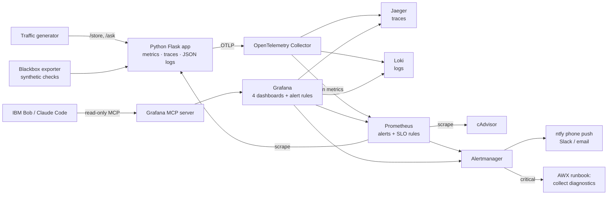

| Area | What is in the repository |
| --- | --- |
| **App** | Flask service with Prometheus metrics, OpenTelemetry traces, JSON logs with trace IDs, a GenAI demo endpoint and a prompt-injection drill ([`app/app.py`](app/app.py)) |
| **Observability** | Prometheus, Grafana, Alertmanager, Loki, Jaeger, OpenTelemetry Collector, blackbox exporter, cAdvisor; all config as code under [`k8s/`](k8s/) |
| **Reliability** | SLOs with multi-window burn-rate alerts, runbooks, incident process, postmortem template, ORR ([`docs/`](docs/)) |
| **Automation** | Ansible playbooks and AWX, Terraform, Helm, Kustomize |
| **Delivery** | GitHub Actions CI/CD, ArgoCD GitOps, rolling updates and rollback, Argo Rollouts canary gated by the SLO |
| **Resilience and guardrails** | LitmusChaos experiments, Kyverno policies, SBOM, image scanning and signing |
| **AI-assisted SRE** | Shared [`AGENTS.md`](AGENTS.md) for every AI coding agent (IBM Bob, Claude Code and others), read-only MCP access, guard hooks, injection drill ([`docs/AI-SRE.md`](docs/AI-SRE.md)) |

## Quick start

On a **Mac** (Homebrew + Colima) or **Windows** (WSL2 + Ubuntu), with Docker, Minikube and kubectl installed ([guide, step 2](docs/GUIDE.md#2-install-the-tools-one-time)):

```bash
git clone https://github.com/jaffethalfarotorres/sre-final-project.git
cd sre-final-project
./scripts/deploy.sh          # builds the app and deploys the whole stack (5-10 minutes the first time)
./scripts/dashboards.sh      # opens Grafana, Prometheus, Alertmanager, Jaeger and the app
./scripts/trigger-alert.sh   # in another window: makes a real alert fire in about 2.5 minutes
```

No accounts or credentials are needed. **On Windows with IBM Bob, use PowerShell and skip WSL:** every script also exists as `scripts\*.ps1` (for example `powershell -NoProfile -ExecutionPolicy Bypass -File scripts\deploy.ps1`), and you type `python`, never `python3`. The tunnels can run in the background: `scripts\dashboards.ps1 -Background` (Mac/Linux: `./scripts/dashboards.sh --background`), stopped with `-Stop` / `--stop`.

## The lab path (optional, go deeper)

After the shift, the seven lab parts teach each topic in depth, at your own pace. They are optional; the hour estimates are in the [lab guide](docs/labs/README.md#go-deeper-at-your-own-pace).

| Part | Modules | Course coverage |
| --- | --- | --- |
| [1. Foundations](docs/labs/01-foundations.md) | Setup, instrumentation, Docker, Kubernetes | Ex 1-4 |
| [2. Metrics, dashboards and alerts](docs/labs/02-metrics-dashboards-alerts.md) | Prometheus, Grafana, Alertmanager, Grafana alerting, golden signals | Ex 5-7, 11, 12 |
| [3. SLOs and incidents](docs/labs/03-slos-and-incidents.md) | SLOs and error budgets, synthetic checks, incident response, ORR, GitHub | Topics 0-6 |
| [4. Logs, traces and LLM observability](docs/labs/04-logs-traces-llm.md) | OpenTelemetry, Jaeger, Loki, GenAI telemetry | Ex 8-10 + new |
| [5. Automation, IaC and CI/CD](docs/labs/05-automation-iac-cicd.md) | Forking the repo (M09b), Ansible, AWX, Terraform, Helm, GitHub Actions, DORA, supply chain | Ex 4.1, 13-16 + new |
| [6. GitOps, resilience and guardrails](docs/labs/06-delivery-resilience-policy.md) | ArgoCD, rollbacks, chaos, Kyverno, canary | Ex 17-19 + new |
| [7. AI-assisted SRE](docs/labs/07-ai-assisted-sre.md) | IBM Bob (Claude Code optional), MCP safety, injection drill, game day | New in 2027 |

Every 2026 topic and exercise, and the roadmap.sh DevOps areas, are mapped to files in the [course map](docs/COURSE-MAP.md).

## Optional add-ons (one at a time)
The core stack uses about 3.5 GB. `./scripts/deploy.sh` creates a 4 GB Minikube, which is enough for the core stack only. For the add-ons (16 GB laptop), first create a 6 GB cluster with `minikube start --driver=docker --memory=6144` (run `minikube delete` first if a cluster already exists, because `minikube start` cannot change the memory of an existing cluster; on a Mac, run `colima stop && colima start --cpu 4 --memory 8` first), then run `./scripts/deploy.sh`. Run one add-on, then remove it before the next. On an 8 GB laptop, stay with the core stack. The commands below are for Mac/Linux; on Windows type `python scripts\<name>.py` instead of `python3 scripts/<name>.py`.

Checked live by the author on Minikube in November 2026; the screenshots below show the core stack.

| Add-on | Command | Extra memory | What you should see |
| --- | --- | --- | --- |
| ArgoCD | `python3 scripts/gitops_setup.py` | ~0.8 GB | Synced from GitHub; a manual change is reverted in ~5 s |
| Chaos | `python3 scripts/chaos_test.py` | ~0.5 GB | Pods killed for 30 s, the app kept answering, verdict Pass |
| Canary | `python3 scripts/canary_demo.py` | ~0.4 GB | Good release promoted; bad release stopped at 25% and rolled back |
| Kyverno | `python3 scripts/policy_setup.py` | ~0.5 GB | A non-compliant pod is rejected with 3 policy messages |
| AWX | `python3 scripts/awx_setup.py` | ~2.5 GB | A critical alert launches the diagnostics runbook ~14 s later |
| AI access | `python3 scripts/ai_setup.py` | ~0.05 GB | MCP server (about 60 tools, Grafana writes refused by a Viewer token) and a kubeconfig that cannot delete |
| Bad release | `python3 scripts/rollout_demo.py` | none | Users kept being served; rollback in ~1 s |
| Terraform | `cd terraform && terraform init && terraform apply` | ~0.2 GB | A staging copy of the app created and destroyed from code |

## Evidence

Screenshots of the core stack are in [`docs/screenshots/`](docs/screenshots/). The requirement for each one is in the [grader view](#final-project-grader-view).

**What changed after some captures:** `alerts.yml` (the new `ServiceDown` and `ReplicaDown`, commit cc04db5) and `alertmanager.yaml` (ntfy and routing, commits ea5eab3 and cc04db5) changed after the screenshots taken at commit e308f25: pods, Prometheus targets, Alertmanager, the four Grafana dashboards, Loki and Jaeger. `notification-delivered.png` predates the cc04db5 change, and the two Helm images predate all three files. `slo.yml` last changed in commit 2ea9269, the same commit that added those captures. Only `prometheus-alerts.png` was retaken at the current commit.

**All pods running in every namespace (`kubectl get pods -A`)** (captured 2026-11-19 from the live cluster, commit e308f25, during an alert drill)

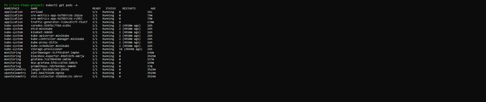

**Prometheus targets UP, including blackbox and cAdvisor** (captured 2026-11-19 from the live cluster, commit e308f25, during an alert drill)


**Prometheus alert rules and their state** (retaken 2026-11-19 at the current commit: shows ServiceDown and ReplicaDown)

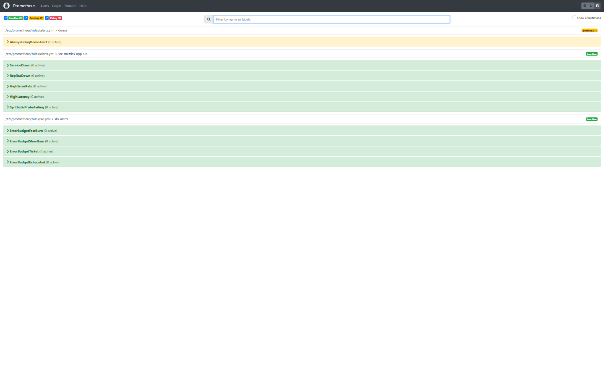

**Alertmanager routing the drill alerts (`HighErrorRate`, `ErrorBudgetFastBurn`, `ErrorBudgetSlowBurn`) to their receivers** (captured 2026-11-19 from the live cluster, commit e308f25, during an alert drill)

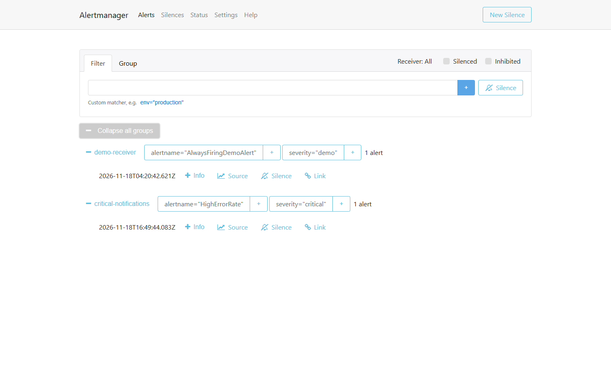

**Grafana: SRE metrics overview dashboard** (captured 2026-11-19 from the live cluster, commit e308f25, during an alert drill)

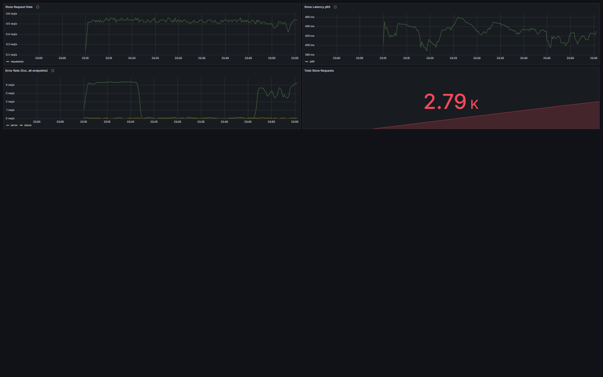

**Grafana: golden signals dashboard** (captured 2026-11-19 from the live cluster, commit e308f25, during an alert drill)

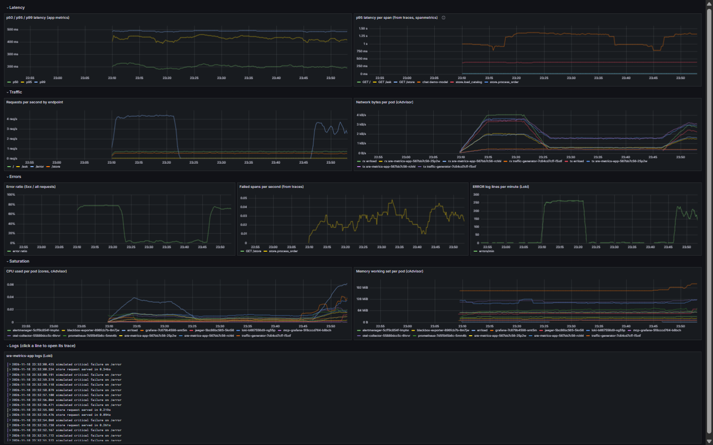

**Grafana: SLO and error budget dashboard** (captured 2026-11-19 from the live cluster, commit e308f25, during an alert drill)

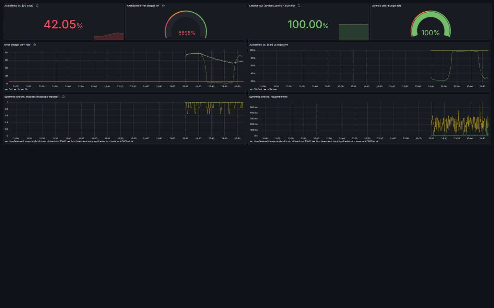

The low availability and the negative budget are expected here: Prometheus had restarted about an hour earlier and two drills sent mostly failing requests since then, so the "30 days" window held only that hour. See [Limits of this lab](docs/SLO.md#limits-of-this-lab).

**Grafana: LLM observability dashboard** (captured 2026-11-19 from the live cluster, commit e308f25, during an alert drill)

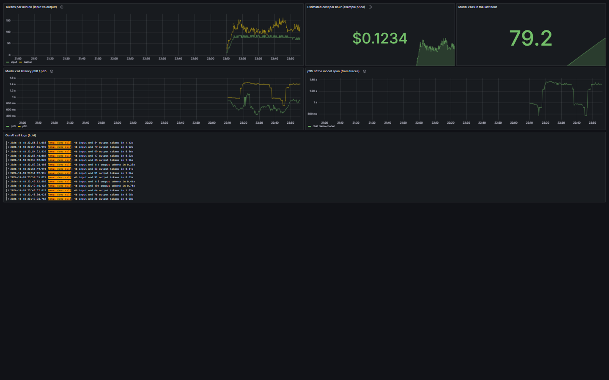

**Grafana Explore on Loki: JSON logs with trace IDs** (captured 2026-11-19 from the live cluster, commit e308f25, during an alert drill)

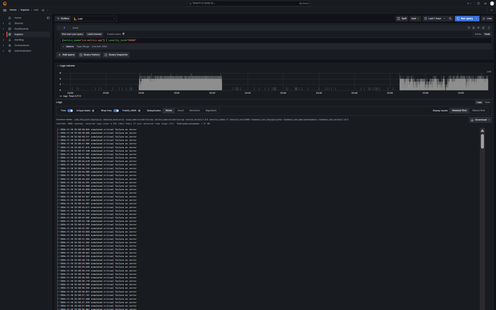

**Jaeger: one failing `/store` request traced through the app (3 spans, the failed step marked)** (captured 2026-11-19 from the live cluster, commit e308f25, during an alert drill)

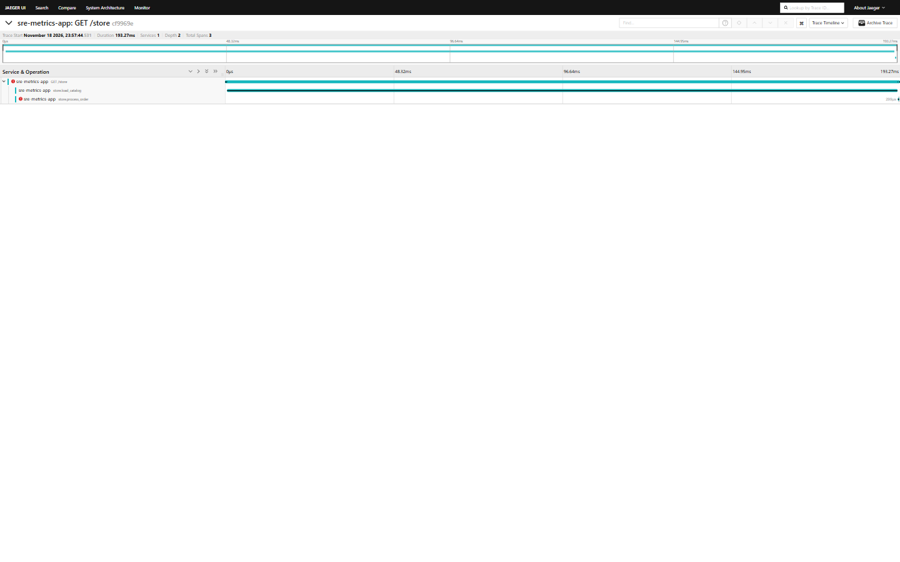

**Mission Control, the lab dashboard (`lab.py play`)** (a local capture of `lab.py play`, 2026-11-19)

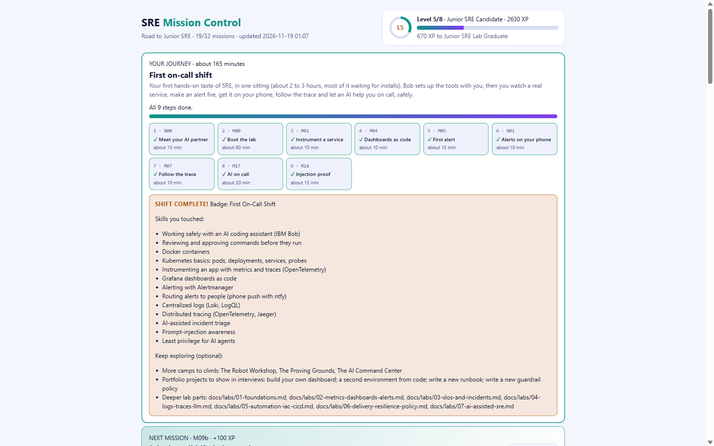

**The First on-call shift, finished** (`lab.py journey` at 9/9 SHIFT COMPLETE on the author's laptop)


**GitHub Actions: a CI run with all jobs green** (a GitHub Actions CI run, run #30 at commit e308f25: all 8 jobs green)

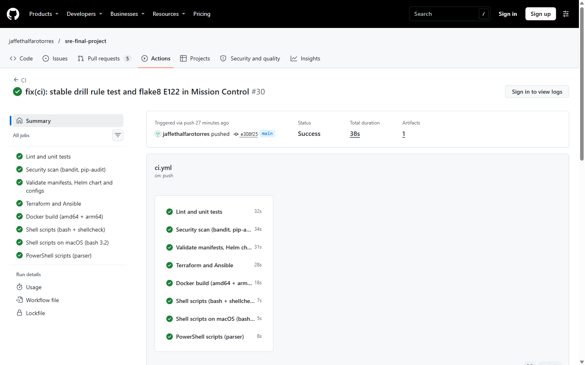

**Helm deployment** (Helm path, earlier capture)

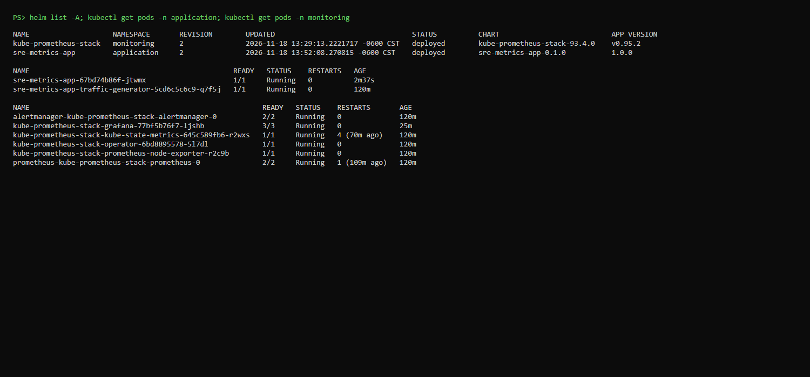

**Prometheus targets on the Helm path** (Helm path, earlier capture)


**Alerts delivered outside the cluster through ntfy** (captured 2026-11-19 during an alert drill, from an IBM laptop with no extra accounts; this is the ntfy web view of the topic, and a phone subscribed to the topic gets the same messages as pushes; the topic shown was replaced afterwards)


## Repository layout

```
app/            Flask service (metrics, traces, logs, /ask GenAI demo, /inject drill)
k8s/            Kustomize stack: manifests + config/ (Prometheus, Grafana, Collector, Loki), ai/, drills/
helm/           App chart + kube-prometheus-stack values (alternative install: ./scripts/deploy.sh --helm)
ansible/        Deploy playbook and incident runbooks      awx/        AWX operator, instance, RBAC
terraform/      Staging environment as code                 gitops/     ArgoCD project and application
chaos/          LitmusChaos experiment as an Argo Workflow  policy/     Kyverno policies
progressive/    Argo Rollouts canary + SLO analysis         scripts/    One-command tools (bash, PowerShell, Python)
docs/           Guide, lab parts, SLO, ORR, incident response, runbooks, course map
.claude/ .bob/  AI assistant configuration (shared rules in AGENTS.md)
```

## CI/CD
- **CI** on every push and pull request: flake8 and pytest, bandit and pip-audit, Kustomize/Helm/kubeconform, promtool, amtool, Collector and Loki config checks, Terraform and Ansible (production lint profile), a multi-arch image build, and the scripts checked on Linux, macOS (bash 3.2) and Windows (PowerShell).
- **CD** on a version tag (`v1.0.0`): image pushed to GHCR (and Docker Hub if its secrets exist), SBOM, Trivy gate, cosign signature, SLSA provenance, a kind smoke test and the Helm chart attached to the GitHub Release.

## Clean up

```bash
kubectl delete namespace application monitoring opentelemetry
minikube stop        # or: minikube delete
```

## Notes
A teaching lab: data is not persisted, and every credential is local and short-lived. Keep real webhook URLs and passwords out of Git; only `*.example.yaml` Secret files are tracked.

## License
MIT, see [`LICENSE.md`](LICENSE.md). Contributions are welcome, see [`CONTRIBUTING.md`](CONTRIBUTING.md).
