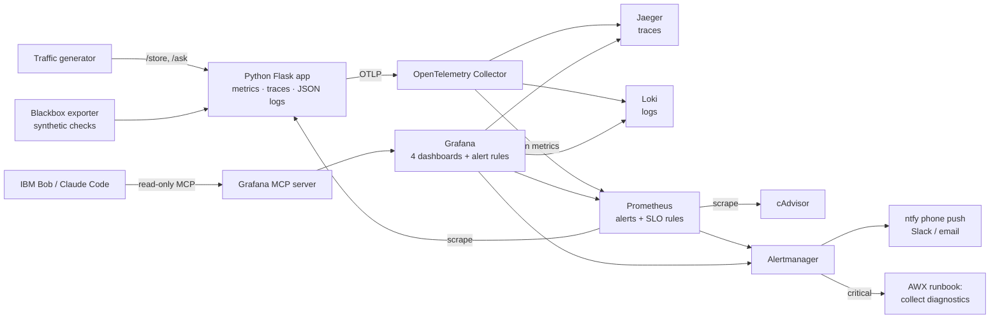
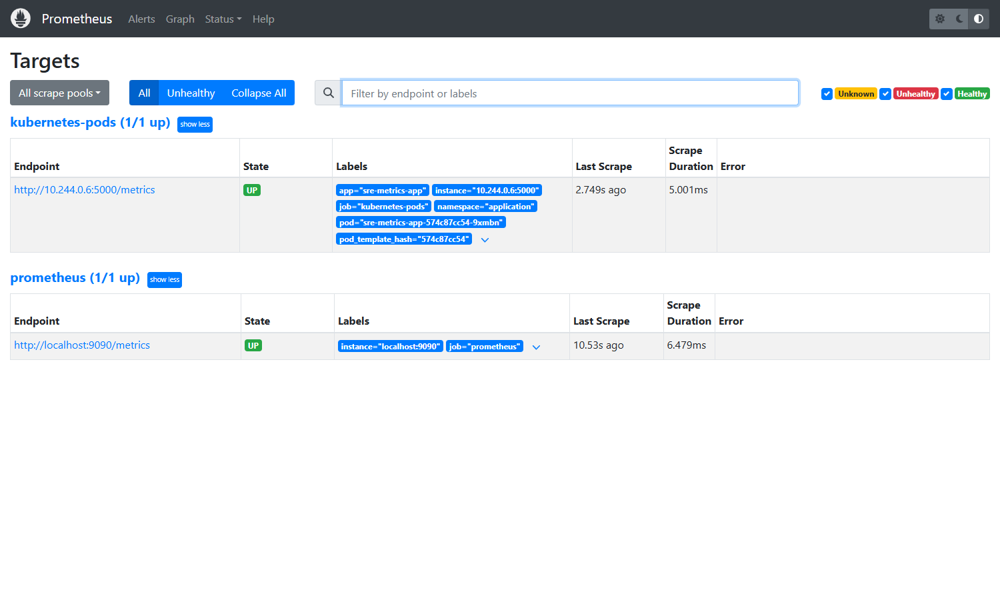
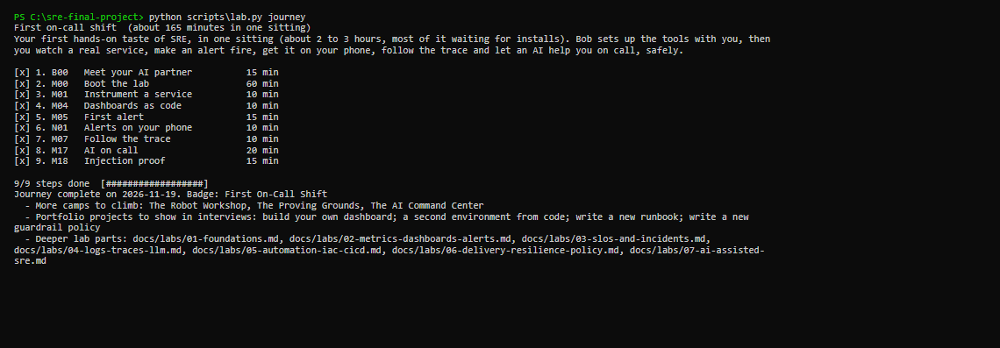
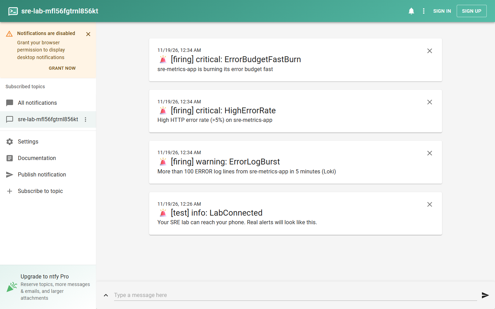

# SRE Academy lab: a reference architecture you set up in one command, then explore

[](https://github.com/jaffethalfarotorres/sre-final-project/actions/workflows/ci.yml)
[](https://github.com/jaffethalfarotorres/sre-final-project/actions/workflows/cd.yml)
[](LICENSE.md)
[](app/app.py)
[](docs/GUIDE.md)
[](#start-here-step-by-step)

> **Note for AI coding agents (IBM Bob, Claude Code, Codex and others) reading this page from a pasted link.** The person is usually not technical and wants to see the lab running, not a plan. Do not write plans or files, and never commit, push or create a repository. With their OK: clone `https://github.com/jaffethalfarotorres/sre-final-project.git`, tell them to open that folder (File > Open Folder) so that you load its `AGENTS.md` and `.bob/` rules, then follow `AGENTS.md`, section "First message". In short, run `python scripts/lab_up.py` (Mac and Linux: `python3`). It sets everything up and ends with one line: `LAB_UP RESULT: DONE`, `NOT_FINISHED`, `NEEDS_HUMAN` or `FAILED`. If it says NOT_FINISHED, run the same command again; it continues where it stopped. Do not run it as a background task: it already manages its own background worker. Then give the tour (`python scripts/lab_up.py --tour 1`) and fire the drill (`--drill`). A teacher who wants a written check also gets `python scripts/smoke_test.py --cluster --report reports/smoke-test.md`.

## What this is

A small online shop, **Nimbus Store**, running on your laptop and watched by the tools real SRE teams use: **Prometheus** (numbers over time), **Alertmanager** (who gets woken up), **Grafana** (charts), **Loki** (logs), **Jaeger** and **OpenTelemetry** (the path of one request), all on **Kubernetes**. SRE (Site Reliability Engineering) is the work of keeping online services running well.

It is meant to be read as a **reference architecture**: each tool is configured the way its own documentation recommends, so you can see how these things should be structured, and why. Setting it up is normally the hard part, so your **AI coding agent does it for you** with one command. After that the time is yours: look around, break things on purpose, read the files, ask the agent anything, and learn at your own pace. No technical background is needed, and nobody grades it.

It is for learners from any background, for classmates and teachers, and for the author's own study and practice.

<a id="start-with-your-ai-coding-agent"></a>
## Start here: step by step

You will not type commands: your agent types them, you click **Approve** and watch, and it explains each thing in plain words. Plan about 1 hour the first time in total (the automatic setup itself is 15-40 minutes, mostly downloads; the rest is the tour). You need a laptop with 16 GB of memory (8 GB works, slower) and 25 GB of free disk. On an IBM-managed laptop, if something is blocked, send IT the [request template](docs/IT-REQUEST.md).

1. **Get IBM Bob.** IBMers: install it from [bob.ibm.com](https://bob.ibm.com) and sign in. Others can start a free trial there. (Claude Code, Codex and other agents also work: they read the same `AGENTS.md`.)
2. **Open the lab in Bob.** On Bob's welcome page click **Clone Git Repository...**, paste `https://github.com/jaffethalfarotorres/sre-final-project`, pick a folder such as Documents, and when it asks, click **Open**. (If Bob first shows a list called "Open Existing Repository Clone", you have cloned this lab before: pick **Clone again** for a clean start, or pick the existing entry to resume.) If Bob asks whether you trust the authors, click **Yes**. *Why:* Bob reads the lab's rules, modes and commands from the folder you open ([Bob's rules documentation](https://bob.ibm.com/docs/ide/configuration/rules)).
3. **Choose the mode: SRE Lab Guide.** At the bottom of the Bob chat, click the mode name (it says **Agent** at first) and pick **SRE Lab Guide**. This lab ships that mode on purpose: it is the one that knows the whole lab. (Shortcut on Windows: Ctrl+. ; on Mac: Cmd+. .)
4. **Optional, makes it hands-free.** Let Bob run only the lab's own commands without asking each time. Open Settings > **Execute** and, under Allowed Commands, add `python scripts/lab_up.py`, `python scripts/smoke_test.py` and `python scripts/lab.py` (on a Mac use `python3`). Then open **Permissions** (beside the mode picker) and tick **Execute**. Bob matches only the start of each command, so everything else still asks ([how Allowed Commands work](https://bob.ibm.com/docs/ide/features/auto-approving-actions)). Never add plain `python` or `powershell`.
5. **Type one command:** `/start-lab` and press Enter. Bob leads the whole session: it explains what it will do, asks one OK, runs `python scripts/lab_up.py`, then tours every tool and breaks the shop on purpose with you. Any time you have a question, type `/explain` and a tool name, or just ask in plain words. (No slash commands in your agent? Send the sentence `Set up the lab and show me every tool working.`)
6. **Click Approve, then wait.** The first run takes 15-40 minutes (it downloads Kubernetes and the images). If Windows asks "Do you want to allow this app to make changes?", click **Yes**. If Docker Desktop opens for the first time, accept its terms and wait until it says it is running. The command always ends with one clear line: `DONE`; `NOT_FINISHED` (Bob runs it again and it continues); `NEEDS_HUMAN` (it says what you must do); or `FAILED` (it says why).
7. **Take the tour.** Bob opens each tool in your browser, one at a time, and tells you what you are looking at:

   | Page | What it is |
   | --- | --- |
   | <http://localhost:5000> | **Nimbus Store**, the shop |
   | <http://localhost:9090/targets> | **Prometheus**: everything it measures, all green (UP) |
   | <http://localhost:3000> | **Grafana**: live charts. No login to look; `admin` / `admin` to change things |
   | <http://localhost:16686> | **Jaeger**: the path of each click through the shop |
   | <http://localhost:9093> | **Alertmanager**: the alarms |

8. **Break it on purpose.** Ask `Break the shop on purpose and show me the alert`. In about 2.5 minutes the alarm `HighErrorRate` fires, and you follow it from Grafana to Prometheus to Alertmanager. Then `Send the alerts to my phone` (free ntfy app, no account) makes the next one reach your phone.
9. **Explore.** Everything is running now. Read [docs/EXPLORE.md](docs/EXPLORE.md): for each tool it shows what good looks like, where it lives in this repository, a few safe experiments, and questions to ask your agent. Say `Stop the lab` when you are done (it frees the memory); `Start the lab again` resumes.

<details>
<summary>Only have the link, or using another agent? Paste this instead</summary>

Open an empty folder in your agent (in Bob: File > Open Folder), choose the **Agent** mode and paste:

```text
Set up the SRE lab from https://github.com/jaffethalfarotorres/sre-final-project on my laptop and show me every tool working. I am not technical: do the work for me and explain in plain words. Follow the "Note for AI coding agents" in its README. Ask me for one OK before you start.
```

The agent clones the repository and asks you to open the cloned folder (File > Open Folder) so that it can load the lab's rules; continue there. Other agents: paste `Read AGENTS.md and set up the lab for me`. If you cannot reopen your workspace, keep working from the clone (use its path in every command); the scripts do not depend on the open folder, only the rules loading does.
</details>

**Prefer the command line, without an agent?** `git clone` the repository, then run `python scripts/lab_up.py` (Mac: `python3`). In a terminal it runs in the foreground and shows everything live. `--status` shows where it is, `--tour 1` to `--tour 7` is the tour, `--drill` breaks the shop, `--stop` pauses the lab. More: [docs/GUIDE.md](docs/GUIDE.md).

## Where to go next

| You are... | Go to |
| --- | --- |
| **A learner** | [docs/EXPLORE.md](docs/EXPLORE.md) (the map of the tools), then the [lab guide](docs/labs/README.md) (7 optional parts, from foundations to AI-assisted on-call) |
| **The grader** | The [grader view](#final-project-grader-view) below. To check it yourself, say "I want to check the project" to your agent (Bob: `/smoke-test`), or run `python scripts/smoke_test.py --cluster` (about 2 minutes, read-only) |
| **Running a workshop** | [docs/WORKSHOP.md](docs/WORKSHOP.md): a timed agenda for one facilitator and about 30 people, pre-work, catch-up rules and how to measure the timings |
| **A professor or team lead** | The [instructor notes](docs/instructor/README.md), the [course map](docs/COURSE-MAP.md) and the [Road to Junior SRE](docs/JOURNEY.md) (camps, badges, reuse for onboarding) |
| **A hiring manager** | [What you get](#what-you-get), [How this was built](#how-this-was-built), the [evidence](#evidence) and a real [drill postmortem](docs/postmortems/2026-11-19-alert-drill-and-ai-triage.md) |

This repository is also my SRE Academy 2026 final project. There is no presentation: the repository is the whole submission, and the [FAQ](docs/FAQ.md) answers the questions I would get in person, with links to the proof.

## What you get



| Area | What is in the repository |
| --- | --- |
| **App** | Flask service with Prometheus metrics, OpenTelemetry traces, JSON logs with trace IDs, a GenAI demo endpoint and a prompt-injection drill ([`app/app.py`](app/app.py)) |
| **Observability** | Prometheus, Grafana, Alertmanager, Loki, Jaeger, OpenTelemetry Collector, blackbox exporter, cAdvisor; all config as code under [`k8s/`](k8s/) |
| **Reliability** | SLOs with multi-window burn-rate alerts, runbooks, incident process, postmortem template, ORR ([`docs/`](docs/)) |
| **Automation** | Ansible playbooks and AWX, Terraform, Helm, Kustomize |
| **Delivery** | GitHub Actions CI/CD, ArgoCD GitOps, rolling updates and rollback, Argo Rollouts canary gated by the SLO |
| **Resilience and guardrails** | LitmusChaos experiments, Kyverno policies, SBOM, image scanning and signing |
| **AI-assisted SRE** | Shared [`AGENTS.md`](AGENTS.md) for every AI coding agent (IBM Bob, Claude Code and others), read-only MCP access, guard hooks, injection drill ([`docs/AI-SRE.md`](docs/AI-SRE.md)) |

<a id="the-first-on-call-shift"></a>
## Optional: the guided first on-call shift

If you like structure, [BOB-QUICKSTART.md](docs/BOB-QUICKSTART.md) runs the same lab as a guided **first on-call shift**: 9 short steps with a quiz after each, a badge at the end and the skills you practised turned into CV lines. Pick the **SRE Lab Guide** mode in Bob and type `/start-lab` (Claude Code: `/lab`). The longer, game-like path (camps, ranks, portfolio projects) is in [docs/JOURNEY.md](docs/JOURNEY.md). A mission counts only when [`scripts/lab.py`](scripts/lab.py) finds the evidence on your own cluster, and nothing is graded.

<a id="final-project-requirements"></a>
## Final project: grader view

This table maps the official rubric to the repository. Each row links to the file and to the evidence. The [FAQ](docs/FAQ.md#2-from-a-failing-request-to-a-phone-push) walks one failing request all the way to a phone push.

| Requirement | Where it is | Evidence |
| --- | --- | --- |
| 1. Application emits metrics | Python Flask app with Prometheus metrics (numbers over time), OpenTelemetry traces (the path of one request) and JSON logs: [`app/app.py`](app/app.py); tests in [`tests/`](tests/) | [grafana-golden-signals.png](docs/screenshots/grafana-golden-signals.png), [jaeger-trace.png](docs/screenshots/jaeger-trace.png), [grafana-loki-logs.png](docs/screenshots/grafana-loki-logs.png) |
| 2. Kubernetes deployment | Minikube (Kubernetes on one laptop) and Kustomize (built into kubectl), 2 replicas, probes, limits, non-root, rolling updates: [`k8s/application.yaml`](k8s/application.yaml), [`k8s/kustomization.yaml`](k8s/kustomization.yaml), [`scripts/deploy.sh`](scripts/deploy.sh), [`scripts/deploy.ps1`](scripts/deploy.ps1) | [pods.png](docs/screenshots/pods.png) |
| 3. Prometheus scraping | Pull model: Kubernetes service discovery finds the app and the Collector's span metrics, plus cAdvisor and blackbox jobs: [`k8s/config/prometheus/prometheus.yml`](k8s/config/prometheus/prometheus.yml); 6 alert rules in [`alerts.yml`](k8s/config/prometheus/alerts.yml) (one is a pipeline test); 17 recording rules and 4 SLO burn-rate alerts (how fast the error budget is spent) in [`slo.yml`](k8s/config/prometheus/slo.yml) | [prometheus-targets.png](docs/screenshots/prometheus-targets.png), [prometheus-alerts.png](docs/screenshots/prometheus-alerts.png) |
| 4. Grafana dashboards | 4 dashboards as code: overview, golden signals, SLO and error budget, LLM observability: [`k8s/config/grafana/dashboards/`](k8s/config/grafana/dashboards/), [`datasources.yaml`](k8s/config/grafana/datasources.yaml) | [grafana-sre-metrics.png](docs/screenshots/grafana-sre-metrics.png), [grafana-golden-signals.png](docs/screenshots/grafana-golden-signals.png), [grafana-slo.png](docs/screenshots/grafana-slo.png), [grafana-llm.png](docs/screenshots/grafana-llm.png) |
| 5. Alertmanager | Routing by severity, inhibition, receivers for a phone push (ntfy), Slack, email and AWX (automation): [`k8s/alertmanager.yaml`](k8s/alertmanager.yaml); Grafana alerts use the same routes; runbooks in [`docs/runbooks/`](docs/runbooks/) | [alertmanager-alert.png](docs/screenshots/alertmanager-alert.png) |
| 6. Documentation | This README, the [FAQ](docs/FAQ.md), the [guide](docs/GUIDE.md), the [lab parts](docs/labs/README.md), [`LICENSE.md`](LICENSE.md), [`CONTRIBUTING.md`](CONTRIBUTING.md), comments in the code and manifests | [Screenshots](#evidence) |
| Bonus: external notifications | Phone push through [ntfy](https://ntfy.sh) (no account, works on IBM laptops: [`scripts/notify_setup.py`](scripts/notify_setup.py)), plus Slack and email receivers, all in [`k8s/alertmanager.yaml`](k8s/alertmanager.yaml); setup in [guide section 6](docs/GUIDE.md#6-optional-get-alerts-in-slack-and-email) | [notification-delivered.png](docs/screenshots/notification-delivered.png) (HighErrorRate, ErrorBudgetFastBurn and ErrorLogBurst delivered to the ntfy topic; a subscribed phone gets them as pushes) |
| Bonus: Infrastructure as Code (IaC: setup written as files) | [`terraform/`](terraform/), [`ansible/`](ansible/), [`helm/`](helm/), Kustomize in [`k8s/`](k8s/) | [helm-deployment.png](docs/screenshots/helm-deployment.png), [helm-prometheus-targets.png](docs/screenshots/helm-prometheus-targets.png) (Helm path, earlier capture) |
| Bonus: CI/CD (automatic checks and releases) | [`ci.yml`](.github/workflows/ci.yml) (tests, flake8, bandit, pip-audit, kubeconform, promtool, amtool, Terraform, Ansible) and [`cd.yml`](.github/workflows/cd.yml) (builds, scans and signs the image: GHCR, SBOM, Trivy, cosign, provenance) | [ci-green.png](docs/screenshots/ci-green.png), and the badges above |

**Minimum to meet the six requirements:** the core stack from `scripts/deploy.*` (no add-ons needed). Time and steps: [FAQ question 9](docs/FAQ.md#9-what-is-the-minimum-to-meet-the-six-requirements). **Check it yourself in 15 minutes:** [FAQ, Verify everything](docs/FAQ.md#verify-everything-in-15-minutes). **In one command:** `python scripts/smoke_test.py` (add `--cluster` when the lab runs) prints PASS, FAIL or SKIP for unit tests, flake8, the Kustomize render, Helm lint, the promtool rule tests and, with `--cluster`, the live pods, targets, alert rules, Alertmanager and Grafana. It only reads.

The full details are below: [What you get](#what-you-get), [Optional add-ons](#optional-add-ons-one-at-a-time), [CI/CD](#cicd) and [Evidence](#evidence).

## How this was built

I am an SRE Academy 2026 student from a non-technical background. I built this project with an AI coding assistant, and I want to be clear about who did what.

- **What I did:** I set the goals, the scope and the design decisions: a public portfolio project, Minikube on a laptop, Python for the app, a guided lab for the 2027 class led by an AI coding agent (IBM Bob recommended for IBMers), and the safety rules for the AI tools. I directed the work, approved the changes and decided each release. The whole stack runs on my own laptop.
- **What the AI did:** Claude Code (by Anthropic) generated most of the code, the manifests and the documentation, following my direction. It also ran the live checks on my local Minikube cluster. I used AI review panels to find problems before submitting.
- **How to see it:** commits made with AI help carry a `Co-Authored-By` trailer in the Git history.
- **Which agent ran it:** I completed the guided shift on my laptop with Claude Code as the agent ([journey-complete.png](docs/screenshots/journey-complete.png)). IBM Bob also set up the whole lab from the repository link in an empty folder, fired the alert drill and got 12 of 12 from the smoke test (on a laptop that already had Docker, Minikube and kubectl). A fresh AI agent that got only the link did the same. The full install on a brand-new laptop is not yet timed.
- **What I can explain end to end:** the alert path, from a failing request to the metric, the Prometheus rule and the Alertmanager route; the SLO burn-rate alerts and why they use two windows; and how the app is deployed on Kubernetes. I wrote these answers down in the [FAQ](docs/FAQ.md), with the problems the checks found in AI-generated work.

## The lab path (optional, go deeper)

After the shift, the seven lab parts teach each topic in depth, at your own pace. They are optional; the hour estimates are in the [lab guide](docs/labs/README.md#go-deeper-at-your-own-pace).

| Part | Modules | Course coverage |
| --- | --- | --- |
| [1. Foundations](docs/labs/01-foundations.md) | Setup, instrumentation, Docker, Kubernetes | Ex 1-4 |
| [2. Metrics, dashboards and alerts](docs/labs/02-metrics-dashboards-alerts.md) | Prometheus, Grafana, Alertmanager, Grafana alerting, golden signals | Ex 5-7, 11, 12 |
| [3. SLOs and incidents](docs/labs/03-slos-and-incidents.md) | SLOs and error budgets, synthetic checks, incident response, ORR, GitHub | Topics 0-6 |
| [4. Logs, traces and LLM observability](docs/labs/04-logs-traces-llm.md) | OpenTelemetry, Jaeger, Loki, GenAI telemetry | Ex 8-10 + new |
| [5. Automation, IaC and CI/CD](docs/labs/05-automation-iac-cicd.md) | Forking the repo (M09b), Ansible, AWX, Terraform, Helm, GitHub Actions, DORA, supply chain | Ex 4.1, 13-16 + new |
| [6. GitOps, resilience and guardrails](docs/labs/06-delivery-resilience-policy.md) | ArgoCD, rollbacks, chaos, Kyverno, canary | Ex 17-19 + new |
| [7. AI-assisted SRE](docs/labs/07-ai-assisted-sre.md) | IBM Bob (Claude Code optional), MCP safety, injection drill, game day | New in 2027 |

Every 2026 topic and exercise, and the roadmap.sh DevOps areas, are mapped to files in the [course map](docs/COURSE-MAP.md).

## Optional add-ons (one at a time)
The core stack uses about 3.5 GB. `./scripts/deploy.sh` creates a 4 GB Minikube, which is enough for the core stack only. For the add-ons (16 GB laptop), first create a 6 GB cluster with `minikube start --driver=docker --memory=6144` (run `minikube delete` first if a cluster already exists, because `minikube start` cannot change the memory of an existing cluster; on a Mac, run `colima stop && colima start --cpu 4 --memory 8` first), then run `./scripts/deploy.sh`. Run one add-on, then remove it before the next. On an 8 GB laptop, stay with the core stack. The commands below are for Mac/Linux; on Windows type `python scripts\<name>.py` instead of `python3 scripts/<name>.py`.

Checked live by the author on Minikube in November 2026; the screenshots below show the core stack.

| Add-on | Command | Extra memory | What you should see |
| --- | --- | --- | --- |
| ArgoCD | `python3 scripts/gitops_setup.py` | ~0.8 GB | Synced from GitHub; a manual change is reverted in ~5 s |
| Chaos | `python3 scripts/chaos_test.py` | ~0.5 GB | Pods killed for 30 s, the app kept answering, verdict Pass |
| Canary | `python3 scripts/canary_demo.py` | ~0.4 GB | Good release promoted; bad release stopped at 25% and rolled back |
| Kyverno | `python3 scripts/policy_setup.py` | ~0.5 GB | A non-compliant pod is rejected with 3 policy messages |
| AWX | `python3 scripts/awx_setup.py` | ~2.5 GB | A critical alert launches the diagnostics runbook ~14 s later |
| AI access | `python3 scripts/ai_setup.py` | ~0.05 GB | MCP server (about 60 tools, Grafana writes refused by a Viewer token) and a kubeconfig that cannot delete |
| Bad release | `python3 scripts/rollout_demo.py` | none | Users kept being served; rollback in ~1 s |
| Terraform | `cd terraform && terraform init && terraform apply` | ~0.2 GB | A staging copy of the app created and destroyed from code |

## Evidence

Screenshots of the core stack are in [`docs/screenshots/`](docs/screenshots/). The requirement for each one is in the [grader view](#final-project-grader-view).

**What changed after some captures:** `alerts.yml` (the new `ServiceDown` and `ReplicaDown`, commit cc04db5) and `alertmanager.yaml` (ntfy and routing, commits ea5eab3 and cc04db5) changed after the screenshots taken at commit e308f25: pods, Prometheus targets, Alertmanager, the four Grafana dashboards, Loki and Jaeger. `notification-delivered.png` predates the cc04db5 change, and the two Helm images predate all three files. `slo.yml` last changed in commit 2ea9269, the same commit that added those captures. Only `prometheus-alerts.png` was retaken at the current commit.

**All pods running in every namespace (`kubectl get pods -A`)** (captured 2026-11-19 from the live cluster, commit e308f25, during an alert drill)


**Prometheus targets UP, including blackbox and cAdvisor** (captured 2026-11-19 from the live cluster, commit e308f25, during an alert drill)



**Prometheus alert rules and their state** (retaken 2026-11-19 at the current commit: shows ServiceDown and ReplicaDown)


**Alertmanager routing the drill alerts (`HighErrorRate`, `ErrorBudgetFastBurn`, `ErrorBudgetSlowBurn`) to their receivers** (captured 2026-11-19 from the live cluster, commit e308f25, during an alert drill)


**Grafana: SRE metrics overview dashboard** (captured 2026-11-19 from the live cluster, commit e308f25, during an alert drill)


**Grafana: golden signals dashboard** (captured 2026-11-19 from the live cluster, commit e308f25, during an alert drill)


**Grafana: SLO and error budget dashboard** (captured 2026-11-19 from the live cluster, commit e308f25, during an alert drill)


The low availability and the negative budget are expected here: Prometheus had restarted about an hour earlier and two drills sent mostly failing requests since then, so the "30 days" window held only that hour. See [Limits of this lab](docs/SLO.md#limits-of-this-lab).

**Grafana: LLM observability dashboard** (captured 2026-11-19 from the live cluster, commit e308f25, during an alert drill)


**Grafana Explore on Loki: JSON logs with trace IDs** (captured 2026-11-19 from the live cluster, commit e308f25, during an alert drill)


**Jaeger: one failing `/store` request traced through the app (3 spans, the failed step marked)** (captured 2026-11-19 from the live cluster, commit e308f25, during an alert drill)


**Mission Control, the lab dashboard (`lab.py play`)** (a local capture of `lab.py play`, 2026-11-19)


**The First on-call shift, finished** (`lab.py journey` at 9/9 SHIFT COMPLETE on the author's laptop)



**GitHub Actions: a CI run with all jobs green** (a GitHub Actions CI run, run #30 at commit e308f25: all 8 jobs green)


**Helm deployment** (Helm path, earlier capture)


**Prometheus targets on the Helm path** (Helm path, earlier capture)


**Alerts delivered outside the cluster through ntfy** (captured 2026-11-19 during an alert drill, from an IBM laptop with no extra accounts; this is the ntfy web view of the topic, and a phone subscribed to the topic gets the same messages as pushes; the topic shown was replaced afterwards)



## Repository layout

You do not need to open any of these folders: your agent guides you. They are here so you can see how it is built.

```
START HERE (the lab itself)
  README.md  AGENTS.md  scripts/ (lab_up.py is the one command)  k8s/ (the monitoring stack)  app/ (the shop)  docs/

OPTIONAL EXTRAS (each has its own script and lab part; not needed for the tour)
  helm/ ansible/ terraform/ awx/ gitops/ chaos/ policy/ progressive/

FOR MAINTAINERS (CI, tests and agent configuration)
  .github/ tests/ lab/ .bob/ .claude/ CLAUDE.md CONTRIBUTING.md SECURITY.md
```

## CI/CD
- **CI** on every push and pull request: flake8 and pytest, bandit and pip-audit, Kustomize/Helm/kubeconform, promtool, amtool, Collector and Loki config checks, Terraform and Ansible (production lint profile), a multi-arch image build, and the scripts checked on Linux, macOS (bash 3.2) and Windows (PowerShell).
- **CD** on a version tag (`v1.0.0`): image pushed to GHCR (and Docker Hub if its secrets exist), SBOM, Trivy gate, cosign signature, SLSA provenance, a kind smoke test and the Helm chart attached to the GitHub Release.

## Clean up

```bash
python scripts/lab_up.py --stop                                  # pause: stops Minikube, keeps everything (Mac: python3)
kubectl delete namespace application monitoring opentelemetry    # remove the lab from the cluster
minikube delete                                                  # remove the whole local cluster (frees the disk)
```

## Notes
A teaching lab: data is not persisted, and every credential is local and short-lived. Keep real webhook URLs and passwords out of Git; only `*.example.yaml` Secret files are tracked.

## License
MIT, see [`LICENSE.md`](LICENSE.md). Contributions are welcome, see [`CONTRIBUTING.md`](CONTRIBUTING.md).
