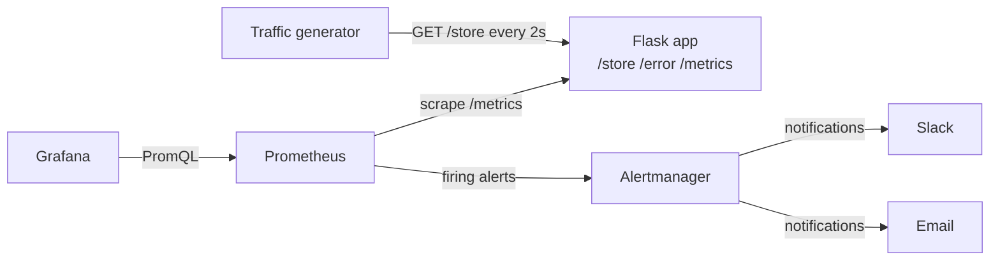
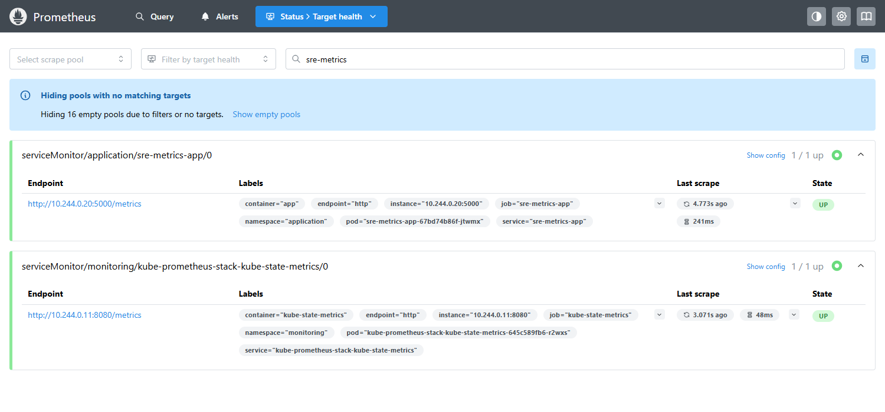

# SRE Metrics Demo

[](https://github.com/jaffethalfarotorres/sre-final-project/actions/workflows/ci.yml)
[](https://github.com/jaffethalfarotorres/sre-final-project/actions/workflows/cd.yml)
[](LICENSE.md)
[](app/app.py)

A small Kubernetes observability project for the SRE Academy final project. A Python 3.10 Flask application (`app/app.py`, instrumented with `prometheus_client` and tested with pytest) exposes Prometheus metrics. Prometheus scrapes and evaluates alert rules, Alertmanager sends notifications to Slack and email, and Grafana visualizes the data. It can be deployed with plain manifests or with Helm, and it is validated by GitHub Actions.

## Architecture



| Namespace | Components |
| --- | --- |
| `application` | `sre-metrics-app` (Gunicorn, 1 worker + 4 threads), `traffic-generator` |
| `monitoring` | Prometheus, Alertmanager, Grafana (raw manifests) or kube-prometheus-stack (Helm) |

## Requirements covered

| Requirement | Implementation |
| --- | --- |
| 1. Application | [`app/app.py`](app/app.py): `http_requests_total` (counter) and `http_request_duration_seconds` (histogram). `/store` fails about 5% of the time and `/error` always fails, so alerts have real signals. |
| 2. Kubernetes deployment | [`k8s/`](k8s/) manifests for Minikube, with resource limits, probes and a non-root container. |
| 3. Prometheus | Pod discovery by annotation (raw) or a `ServiceMonitor` (Helm). Rules in [`k8s/prometheus.yaml`](k8s/prometheus.yaml). |
| 4. Grafana | Provisioned datasource and a 4-panel dashboard (request rate, p95 latency, error rate, total requests). |
| 5. Alertmanager | Deployed with severity-based routing. |
| 6. Documentation | This README, [`LICENSE.md`](LICENSE.md), [`CONTRIBUTING.md`](CONTRIBUTING.md), commented code and screenshots. |
| Bonus: notifications | Slack and email receivers in [`k8s/alertmanager.yaml`](k8s/alertmanager.yaml). |
| Bonus: IaC | Helm chart [`helm/sre-metrics-app/`](helm/sre-metrics-app/) plus `kube-prometheus-stack` values ([`helm/values-monitoring.yaml`](helm/values-monitoring.yaml)). |
| Bonus: CI/CD | [`.github/workflows/ci.yml`](.github/workflows/ci.yml) and [`cd.yml`](.github/workflows/cd.yml). |

## Alert rules

| Alert | Condition | Severity |
| --- | --- | --- |
| `ServiceDown` | `up == 0` for 1 minute | critical |
| `HighErrorRate` | 5xx ratio above 5% for 2 minutes | critical |
| `HighLatency` | p95 latency above 500 ms for 2 minutes | warning |
| `AlwaysFiringDemoAlert` | `vector(1)`, a smoke test for the alert pipeline | demo |

The built-in 5% error rate on `/store` stays below the 5% threshold on purpose. To trigger `HighErrorRate`, generate load on `/error` (see [Trigger an alert](#trigger-an-alert)).

## Prerequisites

- Docker Desktop running
- [Minikube](https://minikube.sigs.k8s.io/docs/start/) with the Docker driver
- `kubectl`
- [Helm 3](https://helm.sh/) (only for the Helm path)
- PowerShell on Windows, or Bash/WSL2

## Configure notifications

Alertmanager reads its credentials from a Kubernetes Secret that is **never committed**.

1. Copy the example and fill in your values:
   ```bash
   cp k8s/alertmanager-secret.example.yaml k8s/alertmanager-secret.yaml
   ```
   - `slack-webhook-url`: a Slack incoming-webhook URL.
   - `smtp-auth-password`: an SMTP password or app password (for example a Google App Password).
2. In [`k8s/alertmanager.yaml`](k8s/alertmanager.yaml) (and [`helm/values-monitoring.yaml`](helm/values-monitoring.yaml) for Helm), set `smtp_from`, `smtp_auth_username` and the `to:` addresses to your own.

All three files are listed in `.gitignore`. The deploy scripts stop with a clear message if a Secret file is missing.

## Deploy

From the repository root, choose one shell and one method.

**Raw manifests**

```powershell
./scripts/deploy.ps1
```

```bash
chmod +x scripts/deploy.sh
./scripts/deploy.sh
```

**Helm**

```powershell
./scripts/deploy.ps1 -Helm
```

```bash
./scripts/deploy.sh --helm
```

The scripts start Minikube when necessary, build the image inside Minikube, apply the Secret, deploy the stack and wait for the rollouts. See [`helm/README.md`](helm/README.md) for the Helm details and image overrides.

## Access the services

Run each command in a separate terminal.

| Service | Raw manifests | Helm |
| --- | --- | --- |
| Grafana | `kubectl port-forward -n monitoring service/grafana 3000:3000` | `kubectl port-forward -n monitoring service/kube-prometheus-stack-grafana 3000:80` |
| Prometheus | `kubectl port-forward -n monitoring service/prometheus 9090:9090` | `kubectl port-forward -n monitoring service/kube-prometheus-stack-prometheus 9090:9090` |
| Alertmanager | `kubectl port-forward -n monitoring service/alertmanager 9093:9093` | `kubectl port-forward -n monitoring service/kube-prometheus-stack-alertmanager 9093:9093` |

- Grafana: <http://localhost:3000>, login `admin` with the password you set in `k8s/grafana-secret.yaml`.
- Prometheus: <http://localhost:9090>, open **Status > Targets** and confirm the app is `UP`.
- Alertmanager: <http://localhost:9093>, wait about a minute for `AlwaysFiringDemoAlert`.

## Trigger an alert

```bash
kubectl -n application port-forward service/sre-metrics-app 5000:5000
# in another terminal: send failing requests for a few minutes
while true; do curl -s -o /dev/null http://localhost:5000/error; sleep 0.2; done
```

After about two minutes `HighErrorRate` fires, and a notification arrives in Slack and email.

## Verification

```bash
kubectl get pods -A
```

All application and monitoring pods are Running, the Prometheus target is UP, the Grafana panels contain data, and Alertmanager shows the alerts.

## Evidence

Screenshots of the working deployment are stored in [`docs/screenshots/`](docs/screenshots/).

**All pods running** (`kubectl get pods -A`)


**Prometheus target UP** (Status > Targets)


**Grafana dashboard with live data**


**Prometheus alerts**


**Alertmanager with `AlwaysFiringDemoAlert` and a firing `HighErrorRate`** (triggered by load on `/error`)


**Helm deployment** (`helm list -A` and the pods of both namespaces)


**Prometheus target UP through the Helm `ServiceMonitor`**



> Slack and email routing is configured, but the committed example uses placeholder credentials. Alertmanager logs show delivery attempts failing with `no_team` (Slack) and `535 BadCredentials` (SMTP) until real credentials are supplied in `k8s/alertmanager-secret.yaml`.

## CI/CD

- **CI** runs on every push and pull request: flake8, pytest, `helm lint`, `kubeconform`, `promtool check rules`, `amtool check-config` and a Docker build.
- **CD** runs on `v*` tags (for example `git tag v1.0.0 && git push --tags`) and manually from the Actions tab. It pushes the image to Docker Hub and runs a `kind` smoke test. It needs the repository secrets `DOCKERHUB_USERNAME` and `DOCKERHUB_TOKEN`.

Run the checks locally:

```bash
pip install -r requirements-dev.txt
flake8 app tests --max-line-length=120
pytest tests -q
helm lint helm/sre-metrics-app
```

## Cleanup

```bash
kubectl delete namespace application monitoring
# Helm: helm uninstall sre-metrics-app -n application && helm uninstall kube-prometheus-stack -n monitoring
```

## Notes

This is a classroom demonstration. Data is ephemeral, and the Grafana demo password is for local use only. Keep real webhook URLs and passwords out of Git.

## License

MIT, see [`LICENSE.md`](LICENSE.md). Contributions are welcome, see [`CONTRIBUTING.md`](CONTRIBUTING.md).
